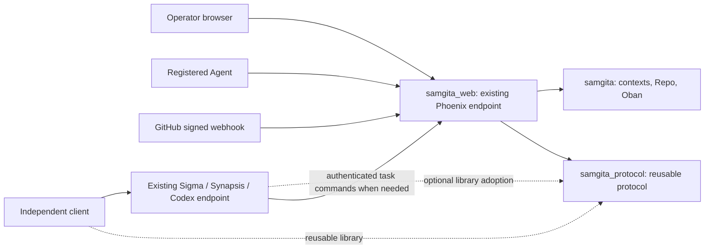

# Samgita agent-neutral platform design

Date: 2026-10-22. Status: executable design; P0 accepted and independent P2 authorized by the user. Platform implementation remains gated.

## 1. Authority and phase boundary

Samgita registers Projects and Agents, connects repositories/GitHub, owns validated project/task management state, and emits durable scheduled and external events. Agents decide how to reason, plan, delegate, and execute. No Samgita RARV loop, mandatory PRD, swarm taxonomy, development phase pipeline, or preferred Agent implementation remains in the target.

This design, [implementation plan](implementation-plan.md), and [acceptance contract](acceptance.md) supersede conflicting target requirements in `docs/prd.md`, `docs/architecture.md`, `docs/plan.md`, `docs/agent-hub-rebuild-design.md`, and `docs/agent-hub-removal-inventory.md`. Those documents also record the separately authorized foundation refactor. Their fresh-database, no-migration, unique-Project-URL, and universal-Channel requirements do not establish this redesign's migration or target contract.

P0 changed only these three documents and conflicting sections of `AGENTS.md`. The later user-authorized P2 implements independent protocol packages, an optional transport/fake Agent, a pinned scoped Codex adapter and standalone consumer. Its bounded scope and evidence are in [protocol phase 2](protocol-phase-2.md). No platform integration, database operation, historical-data deletion, external service change, deployment or push is included. Other stages require separate authorization and stop at their own gates.

### Decisions and alternatives

| Decision | Reason and tradeoff |
| --- | --- |
| Adapt in place with additive schema changes and a fenced cutover | Preserves records and references; requires a bridge release, backfill manifest, and reconciliation instead of a simpler destructive rebuild. |
| Keep app-server protocol code in an independent package here | Reusable by clients and service hosts without Samgita or Backplane. Service owners still implement their handlers and authentication. |
| Keep authoritative management state in PostgreSQL; planning in Agents | Prevents duplicate ownership without imposing an execution method. An offline Agent cannot finalize Task state until its command is accepted. |
| Permit direct client/Agent/service communication | Avoids a mandatory proxy and preserves existing endpoints. Direct runtime messages alone cannot change Samgita's Task state. |

A fresh replacement database would lose the required continuity. Renaming the provider façade would retain local execution and implementation-specific semantics. Moving the protocol into Backplane or starting a Sigma clone in Samgita would violate ownership boundaries. These alternatives are rejected.

## 2. Inspected system and evidence limits

Audited historical baseline: Samgita `2bc3765ac94e1faea50f061b6938c0ef51e6f92b`, clean local HEAD before the original design phase; then two local commits ahead of `origin/main`. The evidence links below use that immutable revision under the verified origin `https://github.com/gsmlg-opt/Samgita.git`, not the merged checkout. Source inspection, not a production inventory, established the following:

| Historical source at the audited revision | Observed behavior and implication |
| --- | --- |
| [Project schema](https://github.com/gsmlg-opt/Samgita/blob/2bc3765ac94e1faea50f061b6938c0ef51e6f92b/apps/samgita/lib/samgita/domain/project.ex), [initial migration](https://github.com/gsmlg-opt/Samgita/blob/2bc3765ac94e1faea50f061b6938c0ef51e6f92b/apps/samgita/priv/repo/migrations/20260129100000_create_projects.exs) | Project already has a UUID primary key. `git_url` is required and unique, but referencing tables use `projects.id`. Preserve UUIDs rather than rekeying records. |
| [Task schema](https://github.com/gsmlg-opt/Samgita/blob/2bc3765ac94e1faea50f061b6938c0ef51e6f92b/apps/samgita/lib/samgita/domain/task.ex), `domain/task_dependency.ex`, `projects.ex` | Task management, execution counters, provider worker IDs, PRD payloads, dependency arrays, and edge-table scheduling are mixed. Task rows can survive while those responsibilities separate. |
| [Core supervision](https://github.com/gsmlg-opt/Samgita/blob/2bc3765ac94e1faea50f061b6938c0ef51e6f92b/apps/samgita/lib/samgita/application.ex), `project/{supervisor,orchestrator,recovery}.ex` | Horde workers, provider health/sessions, Codex launchers, and automatic recovery run alongside Repo/Oban. Recovery can restart paused projects and reset running Tasks. Queue pausing alone cannot fence legacy execution. |
| `agent/worker.ex`, `workers/{bootstrap,planning,agent_task,quality_gate}_worker.ex` | Local RARV, PRD decomposition, fixed phase progression, local tools and Git effects implement the former product. They are not the new architecture. |
| `apps/samgita_provider/lib/**`, `codex_app_servers{,/runtime}.ex` | Local CLI/API providers and privileged Synapsis adapter; Codex management launches a CLI/SSH tunnel, rather than implementing an app-server wire protocol. |
| [Events](https://github.com/gsmlg-opt/Samgita/blob/2bc3765ac94e1faea50f061b6938c0ef51e6f92b/apps/samgita/lib/samgita/events.ex), [webhook delivery](https://github.com/gsmlg-opt/Samgita/blob/2bc3765ac94e1faea50f061b6938c0ef51e6f92b/apps/samgita/lib/samgita/workers/webhook_worker.ex) | PubSub and generic outbound hooks exist without an atomic domain-event/outbox contract. WebhookWorker shares `agent_tasks` with execution jobs. It is not GitHub ingress. |
| [Configuration](https://github.com/gsmlg-opt/Samgita/blob/2bc3765ac94e1faea50f061b6938c0ef51e6f92b/config/config.exs), `workers/snapshot_worker.ex`, `apps/samgita_memory/lib/samgita_memory/workers/compaction.ex` | Snapshot cleanup deletes history beyond ten snapshots; daily memory compaction prunes records. Disable those producers before taking a future preservation baseline. |
| [Runtime config](https://github.com/gsmlg-opt/Samgita/blob/2bc3765ac94e1faea50f061b6938c0ef51e6f92b/config/runtime.exs), [release helper](https://github.com/gsmlg-opt/Samgita/blob/2bc3765ac94e1faea50f061b6938c0ef51e6f92b/apps/samgita/lib/samgita/release.ex) | Main and memory Repos use the same database but separate pools/migrations/Oban instances. The release helper enumerates only main `ecto_repos`; it does not establish that both migration histories are applied. |
| [Router](https://github.com/gsmlg-opt/Samgita/blob/2bc3765ac94e1faea50f061b6938c0ef51e6f92b/apps/samgita_web/lib/samgita_web/router.ex), `controllers/*`, `live/*` | UUID routes and REST API-key/rate-limit boundaries exist. Browser controls start orchestration/Codex, PRD chat calls providers, and `/agents` is a static swarm catalog. These must become registration/management views. |

No implemented GitHub connection or signed inbound GitHub webhook was found in the inspected core/web sources. Live databases, deployments, outstanding jobs, secrets, and remote servers were not inspected. All data-preservation and operational gates below remain future work.

### Merged checkout and reconciliation gate

Merge `d6e9eca` combines design commit `3a344f5` and the separately authorized clean-start source refactor `811eeb9`. The refactor removed legacy source and migration files. The merged checkout contains a two-app foundation: main Repo, PubSub and Oban, the existing web endpoint, and only `20260907000000_create_oban.exs` as its migration; the planned Project/Task domain and reusable protocol are absent. Historical source remains in Git. The merge proves neither a database migration nor historical-data deletion or continuity.

The inventory in §7, mapping sources in §8, and P1 legacy/dual-Repo callsites describe the audited historical system, not files available to modify in this checkout. B0 blocks implementation until an explicit source/migration reconciliation maps the foundation and historical schemas/readers to the preservation contract, identifies any legacy deployment requiring a bridge, and revises bounded file/test scopes. No automatic source restoration, database recovery, migration, or redesign implementation is authorized by this note. The target contracts below remain unchanged.

P2 reconciliation: the independent protocol uses no legacy schema, migration, reader or platform configuration, so its authorized scope creates only standalone protocol packages and updates these contracts. Root app/config/migration wiring remains unchanged. This clears B0 for that bounded slice only; historical-source reconciliation still blocks P1/P3 and cutover.

## 3. Domain and application ownership

### Target application graph

- `apps/samgita`: Projects, repository associations/GitHub connection metadata, Agents and project bindings, Tasks/Attempts, schedules, event inbox/outbox, receipts, and migration authority. Uses Ecto/PostgreSQL and Oban. It does not depend on web or a provider runtime.
- `apps/samgita_web`: existing Phoenix Endpoint, operator REST/LiveView, machine protocol host adapter, and GitHub ingress. It validates transport inputs and delegates to core contexts. It may mount an app-server WebSocket route on its existing endpoint; no separate Sigma server/listener is introduced.
- `apps/samgita_protocol`: independent Mix library with codecs, versioned schemas, capabilities, correlation/errors, pure connection state, host callbacks, bounded replay and conformance fixtures. It depends on neither core, Repo, Phoenix, providers nor Backplane. `samgita_protocol_websocket` holds the optional transport/fake Agent; `samgita_protocol_codex` holds the provider-specific scoped adapter. All three live under `apps/` but omit umbrella configuration/build inheritance and remain outside the platform's explicit app list. Loading core opens no socket or Agent; transport starts only on an explicit consumer call.

The package's public types and callbacks use opaque host context, not Ecto schemas or Samgita database IDs as required base fields. Hub identity extensions are optional. A separate consumer project must compile and test against the package using only its declared dependencies and no umbrella configuration. Package adoption in sibling services is separate work; their actual endpoints remain there.

### Domain owners

| Owner | Authoritative responsibility | Does not own |
| --- | --- | --- |
| `Projects` | Stable Project ID, name/description, management state, version, archival | PRD approval, development phases, filesystem workspace |
| `Repositories` / `GitHub` | Repository identity/aliases, Project associations, verified connection/install scope, inbound delivery deduplication | Project identity, local checkout, tool execution, workflow dispatch |
| `Agents` | Stable registered identity, enabled state, approved capabilities, endpoint metadata, credential references, capacity and Project grants | Model/provider choice, reasoning, Agent-local sessions |
| `Tasks` | Logical work, relationships, versioned transitions, assignment Attempts, leases/fences, accepted outcomes | Decomposition, plan selection, automatic DAG/wave execution, verification council |
| `Events` / `Schedules` | Source events, ordered audit events, schedule occurrences, explicit subscriptions and delivery state | Choosing a planner, automatically executing an event, inferring success from notification delivery |
| External Agent/service | Reasoning, planning, delegation, models, tools, runtime sessions, local files and execution approvals | Direct database writes or unconditional authority over Task state |

Synapsis, Sigma, Codex, and a fake reference Agent all use ordinary registrations and project bindings. Implementation names are descriptive metadata. No default Synapsis destination, fallback provider, role-name authorization, or hardcoded endpoint is allowed. An Agent may manage its own subagents; any subagent writing Samgita must have an explicitly authorized machine identity. A parent registration cannot mint authority implicitly.

### Durable model

All new domain IDs are UUIDs; keep existing IDs and existing integer history IDs unchanged. Use UTC server timestamps and integer versions. These are additive target records, not an instruction to create tables now.

| Record | Essential fields / constraints |
| --- | --- |
| existing `projects` | Existing `id`; add `state`, `version`, adoption/migration provenance. `state`: active, paused, archived. Keep legacy columns as historical fields. |
| `repositories`, `repository_aliases` | UUID; kind, host, optional immutable provider repository ID, display owner/name/URLs, verification state. Unique verified `(provider, host, external_id)`; URLs are mutable aliases. Unverified aliases may remain ambiguous. |
| `project_repositories` | Project UUID + Repository UUID, role, optional primary flag; unique pair and at most one primary per Project. Zero/many repositories per Project; a repository may serve several Projects. |
| `agents`, `agent_credentials`, `agent_connections`, `project_agents` | Approved/advertised capabilities, configured capacity, credential digest or external secret reference, connection generation, expiry/revocation and explicit Project grants. Unique Project-Agent binding. |
| existing `tasks` | Existing `id`/`project_id`/parent; add neutral title/description, `state`, `version`, adopted flag, execution hold, capability requirements, provenance. No PRD or repository required. |
| `task_attempts` | Task/Agent UUIDs, attempt number, state, lease deadline/digest, fence, execution epoch, connection generation, terminal outcome and effect-resolution evidence. Unique Task+number; partial uniqueness for one active Attempt per Task. |
| `command_receipts`, `domain_events` | Principal+command ID unique; semantic request digest and secret-free result/version/event IDs. Events have stable UUIDs and per-Project monotonically allocated sequence, unique Project+sequence. |
| `github_connections`, `external_deliveries` | Host/install/credential reference and enabled state; unique connection+GitHub delivery ID, payload digest and allowlisted event data. No unencrypted private key or installation token. |
| `schedules`, `schedule_occurrences` | Project, expression/timezone, enabled state, revision and next due timestamp; unique schedule+revision+absolute due time. |
| `event_subscriptions`, `event_deliveries` | Explicit source/type/Project filter and Agent binding or approved hook target; unique event+subscription, durable cursor, attempts and next delivery time. |
| `platform_authority`, `migration_mappings` | Singleton execution owner/admission/epoch; resumable per-record mapping, raw identity digest, resolution state and operator decision. No secrets in mapping reports. |

The preservation contract requires existing history tables and both historical migration sets to remain accounted for; their presence in a live database is unverified, and their source files are absent from the merged checkout. B0 must reconcile that gap. A schema expansion is not permission to drop a legacy column, table, extension, FK, or database.

### Project and Task commands

Projects can be paused or archived without changing their IDs. Pausing prevents new claims; it does not assert that running external work stopped. Archival requires no active Attempts and preserves reads/references. New APIs archive instead of invoking legacy cascading deletion.

Allowed Project transitions are active to paused, paused to active, and active/paused to archived after all executions are resolved. Restoring archived to paused is an explicit operator command with a reason; it does not resume work. All claims require an active Project. No Task count or runtime notification changes Project state automatically.

Task states describe management, not development stages:

| Command | Transition / precondition |
| --- | --- |
| create | New adopted Task starts `open`; explicit Project grant and idempotency key required. |
| claim | An adopted `open` Task gets a `leased` Attempt; Task remains open until start. One active Attempt prevents a second claim. |
| start | Current leased owner of an open Task changes Attempt to `running`, Task to `in_progress`. Agent waits for accepted start before effects. |
| block | Current owner or operator changes open/in-progress Task to `blocked` with a reason; active ownership remains until explicitly released or expired. |
| complete / fail | Current running Attempt owner from in-progress/blocked, or operator from open/in-progress/blocked, commits `completed` / `failed` with structured outcome/reason. Close any active Attempt; operator closure fences the former owner. |
| cancel | Operator explicitly changes a nonterminal Task to `cancelled`, invalidates its Attempt, and emits a stop request. This records desired management state; remote stop acknowledgement is tracked separately. |
| reopen | Operator or explicitly granted management Agent changes blocked/terminal Task to `open`, closes/invalidate any active Attempt and increments fence/version. No automatic execution is implied. |
| lease expiry / disconnect | Disconnect alone changes presence only. Expiry closes the Attempt as expired and blocks unfinished work with `ownership_lost`; it never silently replays work. |

Attempt states are `leased`, `running`, `succeeded`, `failed`, `expired`, `released`, `cancelled`; terminal outcomes are immutable. Later cessation/reconciliation evidence is appended separately. Lease renewals cannot exceed the configured execution deadline. Initial test profile: 15-second heartbeat, 120-second lease, 30-second start deadline, 900-second execution deadline, maintenance scan each minute. These limits fence ownership, not an Agent's reasoning steps. Scheduling/delivery retries use bounded transport backoff; a failed Task is reopened only by an explicit command.

Invalidating ownership does not stop remote tools. Cancellation, expiry, operator closure and reopen leave an execution hold whenever the former execution's cessation/outcome is unconfirmed. Such a Task remains unclaimable even when its management state is open. Clear the hold only with authenticated cessation/outcome evidence from its recorded Agent or audited operator reconciliation; neither a timer nor reopen clears it. A terminal report must attest that execution ended. A bounded `samgita/attempt/resolve` command can append resolution evidence for an old Attempt without changing Task state or restoring ownership. Unknown effects remain visible and block reassignment/adoption/cutover.

Agents can propose child Tasks and delegation through these same commands. Validate same-Project parent/relationship IDs and reject cycles. A relationship does not launch work, choose a recipient, or complete a parent automatically. Existing dependency arrays/edges remain historical until reconciled; an Agent can use them as planning input.

For every mutating command, check current authentication, enabled credential/connection, Project grant and platform epoch first. Then look up a successful receipt and replay an identical command before evaluating mutable expected-version/transition/lease preconditions. For a new command, check those preconditions and current Attempt proof before persisting. Machine command sessions may be established over the Hub WebSocket or an authenticated REST connect route; operator commands do not require a machine connection. Explicit operator force/reconciliation commands require a reason and audit event. Machine writers cannot use an operator bypass. Capability matching intersects operator-approved, host-advertised, and Project-binding scopes. An empty scope permits nothing; unspecified optional binding restriction adds no restriction.

Claims serialize capacity by locking the Agent; active unexpired Attempts and unresolved executions count even when disconnected. Lock eligible Tasks with bounded `FOR UPDATE SKIP LOCKED`, recheck adoption/hold/eligibility, and commit the Attempt, Task version, receipt, event and delivery intents atomically. No broadcast or external call occurs inside the transaction. Public core commands return typed results; REST/LiveView/protocol handlers never implement their own state machines.

Global lock order: platform-authority row `FOR SHARE`; Agents ordered by UUID; Projects ordered by UUID; credentials, connections, bindings, repositories and association rows in that table order and UUID order; Tasks ordered by UUID; Attempts ordered by UUID; then receipt/event/outbox inserts. The authority switch takes `FOR UPDATE`. Commands skip absent levels without reversing order. Revocation, binding changes, reaping, adoption and operator commands follow this same order. Candidate scans take no conflicting row locks until the ordered transaction. Receipt uniqueness races retry the whole transaction and replay after reauthentication.

## 4. App-server protocol and routing

### Source profiles are different today

| Implementation inspected | Source/contract observation | Consequence |
| --- | --- | --- |
| Sigma | Local HEAD `3b41ad0be8ed37ce13b5f62acf72d06e82937b80`, root 0.5.0, `sigma_protocol` 0.1.0/wire 1; `apps/sigma_web/lib/sigma_web/{endpoint,agent_socket,session_channel}.ex`, `apps/sigma_protocol/lib/sigma_protocol/envelope.ex` in sibling checkout | `/agent/websocket`, Phoenix `session:<id>` topics, `command`/`event` envelopes with `session.create`, `prompt.submit`, `permission.resolve`. Not demonstrated Codex JSON-RPC compatibility. |
| Synapsis | Local HEAD `7e8832fdf383e41302e50ba16950896553af4a05`; dirty working-source version 0.2.4; `apps/synapsis_server/lib/synapsis_server/endpoint.ex`, `channels/{user_socket,session_channel,agent_daemon_channel}.ex` and `router.ex` under that directory in sibling checkout | `/socket/websocket`, `session:*`/`agent:daemon`, REST sessions and SSE; implementation-specific messages. Not demonstrated Codex app-server compatibility. |
| Codex | Installed `codex-cli 0.163.0`; `codex app-server generate-json-schema --out <temporary-directory>` produced 318 non-experimental schema files during this audit | Candidate reference profile only. Schema generation is not a real-client round-trip or compatibility proof. |

Sibling source versions describe inspected working copies, not deployed releases. Their endpoints stay in their services, irrespective of where reusable protocol code lives. Before implementing a sibling adapter, verify current paths, contract version and actual endpoint authentication again.

Codex schema evidence: `JSONRPCMessage.json` SHA-256 `6da4cc373a7ccd01f5608ad4496eeb4d44b6a9b0d3158e85ed66b59f3c0b5114`; `ClientRequest.json` SHA-256 `6b10888f163f569922d42c41e94a98b4261258abc7581c14eca867c3b125dc6f`. Generated envelope variants use `id/method/params`, `id/result`, or `id/error`, with string/integer request IDs; they do not require a `jsonrpc` field. Do not replace them with a guessed generic envelope or add Hub fields to Codex messages. Commit the selected reference schemas/provenance and conformance fixtures in the later protocol stage.

### Capability groups

Native group names below are defined by the independent P2 contract, not a claim that upstream hosts advertise these names. A host registers handlers explicitly. Unsupported groups return a stable unsupported-method/capability error; they never activate a fallback provider. The future management extensions are not implemented or advertised in P2.

| Group | Contract and example profile methods | Host authority |
| --- | --- | --- |
| Base envelope/handshake | Version `1.0` schemas, typed errors, IDs, `connection/initialize`, bounded sizes/timeouts | Host authenticates before dispatch; native handshake completes on response. |
| `project_events.v1` | `project/event.receive`, `.status`, `.report` | Agent receives/acknowledges, processes and reports a decision; durable receipt, completion and management acceptance are distinct. |
| `sessions.v1` | `thread/start`, `/read`, `/resume`; `turn/start`, `/steer`, `/interrupt`; lifecycle notifications | Runtime host owns reasoning/tools and session lifetime. A thread is not a Task. |
| `streaming.v1` | `item/started`, `/delta`, `/completed`; `stream/resume`, bounded buffers and replay gaps | Host owns stream retention; processed checkpoints advance separately from transport receipt. |
| `approvals.v1` | Bidirectional `approval/request` and correlated approve/deny | Runtime host checks exact request/action/connection/deadline. No automatic approval. |
| `cancellation.v1` | `request/cancel` | Cancellation intent does not prove a running effect ceased. |
| Future `hub.management.v1` | Namespaced `samgita/project/read`, `samgita/task/create`, `samgita/task/transition`, `samgita/task/claim`, `samgita/attempt/start`, `/renew`, `/report`, `/reconcile`, `/resolve` | Samgita contexts alone commit Project/Task/Attempt state. Requires machine identity, binding, proofs and receipts, outside P2. |
| Future `hub.events.v1` | `samgita/event/subscribe`, `/read`, `/ack`; durable source/outbox cursor contract | Samgita owns durable source events/receipts. P2's bounded in-memory replay is not this outbox. |

The native `connection/initialize` selects a supported version and capability intersection and fails missing required groups. It does not use Codex's `initialized` notification. The optional Codex adapter preserves the upstream initialize/initialized sequence, maps six methods and three notifications, and advertises no full native group. Its official reference is `rust-v0.163.0`, commit `83086188ae0614bd882818ff1aa23f3194962012`; selected schemas/hashes/LICENSE/NOTICE are committed in its package. Full/live Codex compatibility remains unverified. Optional tools/files/models/MCP/catalogs and Codex approvals are unsupported. No model account/provider credentials are needed by the native library or fake Agent.

The [P2 contract](protocol-phase-2.md) and [core README](../../apps/samgita_protocol/README.md) define stable event/delivery/causal IDs, UTC creation time, opaque refs, receipt/completion/management-acceptance distinctions, disconnect uncertainty, replay checkpoints, cancellation, bounded buffering, and transport-independent interfaces. Optional RFC 6455 JSON text at `/app-server` can mount on an existing web endpoint; no mandatory central hop or sibling server is introduced.

Wire request IDs correlate one connection; durable Hub commands additionally carry UUID `command_id`, `project_id`, `expected_version` and command payload. Attempt commands include Attempt ID, epoch/fence and lease proof. Canonical semantic request digests exclude transport correlation IDs and all tokens. Duplicate principal+command ID with identical semantics returns the committed receipt; a different digest returns `command_id_conflict`. Reauthenticate and reauthorize connection ownership before receipt lookup. Historical ACKs describe accepted past state and do not authorize current execution. Database failure leaves no success receipt or side effect.

Use token digests for verification and a versioned server-key derivation for replayable lease proofs bound to Agent, Attempt, epoch and fence; key material lives outside database/event/log storage. Active authorization is checked on every command. A lost claim response is reconciled with the same command ID; any replayed proof still requires a fresh successful start/renew against current ownership before effects. Rotated/revoked identities and stale epochs fail closed. Freeze derivation/rotation fixtures before implementing claims.

An authenticated reconnect establishes a new connection generation and disables the previous connection; it does not reassign existing Attempts. `samgita/attempt/reconcile` explicitly rebinds an unexpired Attempt only for the same registered Agent presenting its current proof/epoch/fence and still-valid Project grant. In the ordered transaction, increment its fence, bind the new generation, renew only within the execution deadline, and return a new proof/receipt. The old generation/proof then fails. The Agent must reconcile its durable local execution journal by Attempt ID and continue the same known execution, never start it twice because a socket reconnected. Lost proof, expired ownership or uncertain local effects requires the hold/resolution path, not a fresh claim. Receipt replay precedes mutable fence/version checks after current connection authorization.

The package implements reusable wire/session mechanics and host callbacks. It does not authenticate a database principal, authorize a Project, persist a Task, execute a tool, proxy all traffic, or migrate sibling services automatically.

### Allowed data flows

1. **Operator management:** browser or protected REST -> context command -> atomic state/receipt/event/delivery intent -> response -> post-commit UI notification. Refresh/reconnect rereads authoritative state.
2. **Agent work:** registered Agent -> authenticated Samgita host/API -> claim/start -> Agent's existing runtime performs work -> report -> validated Task transition. A missing/replaced connection never grants a second owner.
3. **Direct session:** client -> existing Sigma/Synapsis/Codex endpoint -> host-owned conversation/tools/events. Samgita may be absent. To attach results to managed work, the authorized Agent separately sends a Task command to Samgita with explicit Task/Attempt identity. Conversation success is not Task completion.
4. **Delegation:** Agent chooses another Agent or creates child Tasks -> explicit registered/bound recipient and ordinary commands. Direct Agent-to-Agent messages are allowed; only Samgita-accepted commands alter its durable state.
5. **No transparent gateway assumption:** relay/proxy operation, if later requested, is an optional transport deployment with separate credentials and approval forwarding rules. Protocol ownership imposes no required network hop.

## 5. GitHub, schedules and event delivery

### GitHub connection

Use an operator-configured GitHub App installation, not a Samgita user/account system. Persist host/app/installation identity, allowed repository IDs, and a secret-manager reference for signing material. Obtain short-lived installation tokens server-side. Initial permissions are metadata/contents/issues/pull-requests read as needed by the selected event set; no write scope, workflow dispatch or automatic repository mutation. Verify installation and repository scope with GitHub before marking associations verified. Revocation/suspension disables ingress routing and new token use while preserving history.

Add a signature-authenticated ingress route distinct from outbound hooks and operator API keys. Capture bounded raw request bytes before JSON parsing; verify `X-Hub-Signature-256` with constant-time HMAC comparison, installation/host/repository scope, event type and delivery ID. Reject invalid signatures before storing an event. Deduplicate connection+delivery ID; same ID with a different body digest is a conflict requiring inspection. Keep an allowlisted payload and digest, not arbitrary headers/tokens. A verified event identifies a repository, then explicitly associated Projects; it never identifies a Project by a mutable URL.

Return success only after durable inbox/event insertion. Retryable persistence failure returns a retryable failure. Delivery retry cannot create duplicate source events. An issue or push event records facts and notifies subscribers; an Agent can propose Task changes through validated commands. Samgita does not automatically turn every issue into a plan or start a development pipeline.

### Scheduled events

A Schedule has an explicit Project, event type/payload template, timezone (UTC by default), expression, revision and operator-enabled state. A durable Oban scanner computes due occurrences in bounded batches and transactionally advances the cursor with each event. Uniqueness on schedule+revision+absolute due time prevents duplicate occurrences across nodes/restarts. DST repeats are distinct UTC instants; a nonexistent local time has no occurrence. Catch-up emits missed real occurrences in bounded batches, with backlog visible; never silently replays legacy jobs as schedule occurrences. Disabling a schedule stops future creation, without erasing already emitted events.

### Events and delivery

Persist domain changes, append-only event rows and delivery intents in one transaction; send only after commit. Each delivery includes stable event ID, Project ID, source/occurrence ID, event type/schema version, sequence and occurred-at time. Subscribe only through explicit Agent-Project bindings or approved hook targets. Zero subscribers leaves the event inspectable; there is no implicit Synapsis subscriber.

Freeze the initial event catalog before parallel implementation: `project.created`, `project.state_changed`, `project.repository_linked`, `task.created`, `task.state_changed`, `attempt.leased`, `attempt.started`, `attempt.closed`, `attempt.effects_resolved`, `schedule.tick`, and allowlisted `github.*` source types, each with `schema_version=1`. State events contain resource ID, before/after state and version, actor identity, command ID and a bounded reason code; never prompts, credentials or arbitrary tool output. Agent/credential registration audit uses the same envelope with no Project sequence until a binding supplies Project scope. Event projection and delivery retries do not create new management events.

Oban delivery is at least once with stable IDs. Receivers deduplicate IDs and acknowledge durable processing; socket PubSub is only a wake-up. Per-Project cursors detect gaps, and authenticated paginated reads recover history. Delivery retry does not change Task state. Recheck revocation, subscription and destination on each attempt. Moving targets or changing secrets does not redirect already accepted work silently; record subscription revision and require explicit redelivery choice.

Adapt existing generic outbound hooks into this contract. Preserve old subscription/job IDs and their legacy HMAC convention until the versioned replacement is accepted. Do not silently resend old deliveries under a new event ID/body/signature. Record delivered/permanent-failure/retryable/unknown outcomes, honor bounded timeout/backoff and `Retry-After`, and separate delivery queues from task-ownership maintenance. Existing notification delivery is simulated; do not claim production email delivery from its `sent` state.

## 6. Security and runtime boundaries

- Preserve single tenancy and infrastructure-protected browser access, existing CSRF/secure-header/session protections, configured `x-api-key` operator API protection and rate limits. No accounts, organizations, browser login or unrelated RBAC. Current ApiAuth allows an empty key list; any deployment relying on API keys must prove keys are configured. This design does not silently change that deployment policy.
- Agent/machine transport always requires credentials, even where an operator API is intentionally infrastructure-only. Scope credentials to registered identity and explicit Project grants; expire, rotate and revoke them. Issue new credentials once with `Cache-Control: no-store`; persist only digests. Inbound machine credentials and outbound service credential references are distinct.
- Do not print or serialize legacy `synapsis_endpoints[*].api_key`, endpoint userinfo/query secrets, installation tokens, webhook secrets, provider keys, lease tokens or approval payloads. Future migration inventories detect secret-bearing fields by key/type and report counts/IDs only. Use encrypted secret storage/references before exposing neutral records. Legacy raw data remains under restricted historical access, not generic API serialization.
- Enforce TLS/WSS and approved destinations for remote connections. Validate host/port/path, redirects and resolved addresses to prevent SSRF/DNS rebinding; private/loopback service targets require explicit operator approval for that registration. Do not accept arbitrary URLs from Agent messages. Never forward a credential to a different host on redirect.
- The inspected Sigma socket requires a protocol token and registered repository. The inspected Synapsis socket accepts connections without checking a machine credential and its REST pipeline only accepts JSON. A Bearer header from the old adapter does not prove authentication. Integration is blocked until the actual service boundary is verified or hardened by its owner; do not expose it by assuming Samgita confers security.
- Authenticate host connections before initialization/dispatch/replay; authorize every Task and event read/write against its actual Project. A nested URL Project ID must match the resource's stored Project ID. Connection presence, capability advertisement, callback URL, session ID and event receipt are not authority.
- Execution permission requests and user approvals remain bound to the originating runtime/request/connection. An approval cannot be replayed into another host or interpreted as a Task grant. Protocol codecs must never auto-approve.
- Bound messages (initial profile 256 KiB), event batches (100), connection buffers, outstanding requests, timeouts and retry counts. Apply machine-identity and source-specific limits in addition to retained operator IP limits. Unknown fields/methods get typed errors; logs/telemetry use allowlisted metadata, not prompts, raw tool output or secrets.

Target active supervision: main Repo, PubSub, Finch and Oban in core; telemetry and the existing Endpoint in web; explicitly started transport connections only. Caches are rebuildable projections. No GenServer per Project/Task, Horde ownership, automatic provider health/startup recovery, Codex/SSH launcher, or second Sigma process. Keep storage/readers needed for quarantined history until a later approved extraction/retirement gate.

## 7. Legacy subsystem inventory

Definitions: **retain** preserves an active responsibility; **adapt** changes its boundary/contract; **quarantine** preserves code/data for bounded drain or read-only history, with no new execution; **retire** removes active behavior only after quarantine/consumer checks. Retirement never means deleting historical rows or rewriting past migrations. Nothing in this table is executed during this phase.

Paths below are repository-relative at the audited historical revision; grouped files share the stated owning behavior. Source removal in `811eeb9` is authorized and already merged; these dispositions specify remaining data/operational obligations, not instructions to restore removed files or evidence that runtime drain/preservation happened.

| Subsystem / inspected path | Disposition | Required handling |
| --- | --- | --- |
| Main Repo and `apps/samgita/priv/repo/migrations/**` | retain | Preserve schema history, IDs and references; expand additively. |
| `domain/{project,task}.ex`, `projects.ex` CRUD/read/stats | adapt | Stable identity and versioned neutral commands; preserve legacy fields/history and archive instead of cascade-delete. |
| `projects.ex` start/resume/restart/terminate/enqueue/retry entrypoints | retire | Fence every caller before cutover; old routes cannot invoke providers or bypass new commands. |
| `project/orchestrator.ex` | retire | Quarantine timers/retries during drain; remove fixed phases, auto-advance, stagnation decisions and role assignment. |
| `project/supervisor.ex`, Horde registry/supervisor in `application.ex` | retire | Inventory Project children and global Agent children separately; stopping one tree is insufficient. |
| `project/recovery.ex` | retire | Fence delayed boot recovery, direct recovery calls and running-to-pending resets before enabling Hub ownership. |
| `agent/worker.ex` | retire | Drain RARV/local side effects; preserve outcome as known or reconciliation-needed. |
| `agent/{types,prompt_builder,context_assembler,result_parser,retry_strategy,claude,worktree_manager,circuit_breaker}.ex` | retire | Remove mandatory roles/models/reasoning/automatic retry and local Git execution only after callers disappear. |
| `agent/message_router.ex`, `domain/agent_message.ex` | adapt / quarantine | Retire Horde/budget/depth execution routing; retain historical messages. Future delegation uses authenticated identities. |
| `agent/activity_broadcaster.ex`, `events.ex`, `telemetry.ex` | adapt | Retain useful operational metrics; replace RARV phases with committed management/delivery projections. |
| `domain/agent_run.ex` | quarantine | Historical synthetic worker IDs, PIDs/nodes and RARV states are not registered Agents or authenticated Attempts. |
| `workers/bootstrap_worker.ex` | retire | Quarantine all nonterminal jobs; no PRD-to-backlog replay. |
| `workers/planning_worker.ex` | retire | Quarantine research/architecture/draft/review/revise jobs and auto-finalization. |
| `workers/agent_task_worker.ex` | retire | No new Horde dispatch or task-running writes; preserve original Oban/task records. |
| `workers/quality_gate_worker.ex`, `quality/**` | retire | Preserve findings/reports; no mandatory council or lifecycle gate. |
| `workers/snapshot_worker.ex`, `domain/snapshot.ex` | quarantine | Stop snapshot creation/pruning; retain all existing JSON/IDs. Snapshots are history, not ownership/recovery authority. |
| `tasks/dependency_graph.ex`, `domain/task_dependency.ex` | adapt | Reuse scoped cycle checks if sound; no wave/critical-path executor. Preserve array/edge divergences for reconciliation. |
| `prds.ex`, `domain/{prd,chat_message}.ex`, PRD chat UI | quarantine | Read-only PRD/chat/version history; retire provider chat/generation and approval-triggered execution. |
| `features.ex`, `domain/feature.ex` | quarantine | Preserve global records; no invented Project link or execution-policy authority. |
| `domain/artifact.ex`, artifact reads | retain | Preserve history/task links/files; new artifact storage and automatic writes are outside scope. |
| `notifications.ex`, `domain/notification.ex` | adapt | Retain history and useful validation/reads; quarantine simulated send/retry behavior until durable event delivery replaces it. |
| `project/memory.ex`, `domain/memory.ex` | quarantine | Preserve table and refs; retire per-Project reasoning memory process. |
| `apps/samgita_memory/**` | quarantine | Preserve `sm_*` records, vectors and migrations; disable formation, embedding, summarization and destructive compaction/cron. Do not remove its Repo/readers until historical access is replaced and verified. |
| `apps/samgita_provider/lib/samgita_provider{.ex,/**}` | retire | Fence Claude Code/API, Codex, Synapsis and session callbacks; not the neutral protocol package. |
| `provider/session_registry.ex` | retire | ETS provider sessions cannot become durable Agent authority. |
| `provider/health_checker.ex` | adapt | Only neutral optional endpoint observation after egress/auth checks; health never confers ownership. |
| `codex_app_servers.ex`, `codex_app_servers/runtime.ex` | retire | Fence local Port/SSH launches; preserve configurations/log provenance, require separate reconciliation of existing processes. |
| `git.ex`, `git/worktree.ex`, Agent worktree helpers | adapt / retire | Retain repository metadata parsing only after identity audit; retire server clone/worktree/commit execution. Preserve ignored/local workspaces. |
| `webhooks.ex`, `domain/webhook.ex`, `workers/webhook_worker.ex` | adapt | Preserve subscriptions and pending deliveries independently of the shared execution queue; version inbox/outbox/signing behavior. |
| Main Oban, `oban_client.ex`, memory Oban and Cron | retain / quarantine | Retain durable job framework; classify by worker/instance, isolate new queues, quarantine legacy producers/retries without deleting jobs. |
| `cache.ex`, `references.ex`, `priv/references/**` | adapt / quarantine | Audit consumers; retain safe read-only legacy references, never inject old lifecycle instructions into new Agent commands. |
| `samgita_web/router.ex`, controllers/JSON, LiveViews/templates | adapt | Register/bind Agents; manage Projects/repositories/Tasks/events/history. Retire execution/PRD/Codex controls; keep UUID read links and access boundaries. |
| `endpoint.ex`, API auth/rate plugs, DuskMoon assets | retain / adapt | Keep platform/UI protections and components; add machine/GitHub transports without a new account system. |
| Mix manifests/releases/config, test support, CI/deployment/devenv | adapt | Preserve working infrastructure; inspect consumers before removing deps. Correct dual-migration tooling, explicit isolated test DBs and guarded rollback before release. No workflow/deploy edit now. |

## 8. Migration mapping and preservation

### Identity and reference mapping

| Legacy source | Target mapping / preservation rule |
| --- | --- |
| `projects.id` | Keep exactly; existing UUID API/UI links and every FK remain valid. Never derive an ID from a URL. |
| `projects.git_url` | Preserve exact raw value as restricted legacy provenance; create mapping to Repository+ProjectRepository and a sanitized alias. A URL change never changes Project identity. |
| HTTPS/SSH URLs, rename/transfer | Resolve host plus immutable GitHub repository ID using an authorized connection. Preserve old aliases. Same normalized URL does not merge Projects. |
| Local path/unknown/unreachable URL | Preserve path/value and unresolved mapping; no network/clone/command side effect. A Project remains usable without a verified repository. |
| `working_path`, `prd_content`, `phase`, `start_mode`, `planning_auto_advance`, `active_prd_id`, `provider_preference`, `synapsis_endpoints`, `config["codex_app_server"]` | Preserve originals; no automatic launch, endpoint enrollment, credential disclosure or new policy. Explicit operator review creates neutral registrations/associations. |
| UUID `project_id` in tasks/runs/artifacts/memories/snapshots/PRDs/notifications/messages | Unchanged, including historical cascades/FK metadata until a later reviewed constraint hardening. Block destructive management commands. |
| Task IDs, parent links, `agent_runs.current_task_id`, `artifacts.task_id` | Unchanged; any orphan/cross-Project references are reported and quarantined, not deleted. |
| `tasks.depends_on_ids`, `dependency_outputs`, `task_dependencies` | Preserve both representations. Compare IDs/types/cycles/scope and record conflicts; never silently pick one or activate old scheduling. |
| `tasks.agent_id`, message sender/recipient IDs, AgentRun PIDs/nodes | Preserve as legacy worker identifiers, not machine registrations/ownership. Register Agents explicitly with new UUIDs. |
| PRDs/chat, artifacts, snapshots, notifications, main memories | Preserve IDs, content, chronology and references; provide restricted read-only history. New API serializers expose allowlisted projections. |
| `sm_memories.scope_id/source_id`, `sm_thinking_chains.scope_id`, `sm_prd_executions.prd_ref`, decisions/events | Preserve opaque values/links. Add mapping only when evidence is unambiguous; unresolved rows remain queryable and counted. |
| Features | Preserve global records without fabricated Project associations. |
| Oban args, webhook payloads, snapshot JSON, nested PRD/URL/task keys | Preserve original payload/history. Add sidecar mapping/provenance for new consumers; never bulk rewrite historical JSON. |

`Git.normalize_url/1` strips prefixes and suffixes; it is not an identity authority. Backfill uses a mapping ledger keyed by source table+primary key+mapping version, deterministic upserts, source digests and resolution decisions. Different Project records pointing to one repository retain different Project IDs. Ambiguous URL-only lookups return an explicit ambiguity error; no first-match redirect.

Keep `projects.git_url` unchanged and write-frozen for migrated Projects. New versioned APIs write repository associations. Make legacy URL optional and remove Project-level URL uniqueness only after legacy writers are fenced and clients use stable IDs; a later additive migration may relax those constraints without removing provenance. Retain old read projections for a measured deprecation period; old execution mutation routes return a typed disabled/gone error after the fence. They must not redirect into new execution silently.

### State mapping and explicit adoption

Add neutral `state`/`version` columns alongside, rather than rewriting, legacy `status`/`phase`. Until cutover legacy status is the sole runtime authority; mapped values are inert previews. After cutover neutral state is authoritative and legacy values are frozen history, with no bidirectional execution writes. Every old Task defaults to `adopted=false`; no mapped row is claimable until explicit review/adoption records an event.

| Legacy state | Neutral projection | Additional condition |
| --- | --- | --- |
| Project pending/running | active | Does not start work; all old execution must be drained/fenced. |
| Project paused | paused | No automatic resume on startup. |
| Project completed | archived | Preserve old status/phase; no active ownership may remain. |
| Project failed | paused | Review reason and unfinished effects before reopening management. |
| Task pending | open | Unadopted; validate content/relationships before any claim. |
| Task blocked | blocked | Preserve reason/dependencies, require explicit adoption/reopen. |
| Task assigned/running | blocked | Mark reconciliation-needed; no fabricated authenticated Attempt and no implicit replay. |
| Task completed | completed | Historical result retained, no replay. |
| Task failed/dead_letter | failed | Retain distinct original status/error/counters. |
| Task skipped | cancelled | Preserve `legacy_skipped` provenance; do not claim a remote cancellation happened. |

Adoption keeps the Task ID and must confirm resolved Project scope/relationships, sanitized command content, no active legacy effect, and an explicit management decision. Synthetic legacy Agent IDs or attempt counters never become new leases. Unknown schema values or unresolved active effects block adoption/cutover rather than receiving a guessed mapping.

### Exclusive authority and in-flight work

Use a bridge release before any new execution. Its durable singleton stores `owner = legacy | none | hub`, `admission_open`, and monotonic `epoch`. Every writer validates it in the same transaction as its change. External dispatch also uses recorded dispatch intent and epoch; a preflight check alone cannot fence an already running CLI/network effect.

1. **Inventory/backup:** identify all deployment nodes, both Repos/migration sets/Oban instances, cron/timers, local Port/OS processes, remote provider sessions, nonterminal Tasks/jobs, subscriptions and filesystem effects. Capture sanitized counts/IDs/hashes and restorable backups. Do not infer absence from this source audit.
2. **Install bridge with legacy ownership:** all old API/UI/context producers, recovery, orchestration retries, provider dispatch/completion and maintenance obey the guard. Unmodified old binaries are removed from writer credentials/network access before proceeding; a new-code flag cannot fence an old node.
3. **Close admissions; drain as legacy sole owner:** no new bootstrap/planning/worker dispatch or destructive cleanup. Permit only recorded executing work to report under its current epoch. Quarantine available/scheduled/retryable/snoozed/discarded jobs by instance+worker+ID; keep original rows and decisions. Worker-specific routing preserves unrelated retained webhook deliveries even though they share `agent_tasks`.
4. **Reconcile effects:** record completion/failure/unknown for each executing job, Horde worker, CLI/Port/SSH process, remote session and delivery. Oban job completion/cancellation or stopping Project.Supervisor is insufficient proof that global workers or external effects stopped. Timed-out/unknown work blocks cutover until explicitly resolved; never bulk reset running Tasks to pending.
5. **Quiesce:** set owner none, increment epoch and close all legacy dispatch paths. Verify all old nodes/credentials/producers are stopped or fenced and no legacy execution remains. Keep retained hook delivery separately fenced by delivery IDs. Backfill/rehearse preservation without any execution owner.
6. **Enable Hub:** after data/reference and operational gates pass, atomically switch owner hub at a new epoch. Only adopted Tasks can be claimed. Legacy APIs, retries, Recovery, cron and stale completions remain rejected after restart or rollback of a node. No per-Project mixed old/new execution mode is permitted.

No actual drain, kill, cancellation, backup, migration or replay is authorized now. Operators choose reconciliation actions for real in-flight work during a separately approved cutover. The acceptance gate proves both persistence fencing and absence of competing external dispatch.

### Rollback

Before Hub writes, roll back application changes only to the guard-aware bridge with admissions closed; additive tables/columns and mappings remain. Re-enabling legacy ownership requires a reviewed legacy-only execution manifest and no Hub execution. Never run destructive down migrations to simulate rollback.

After Hub work starts, close Hub admissions, set owner none/increment epoch, invalidate leases and reconcile externally running work/deliveries. Serve read-only management/history while fixing forward or rolling back to a compatible guard-aware binary that understands the additive schema. Returning to the old PRD executor is not an automatic fallback; Hub-created/adopted work has no valid reverse phase mapping. Unfenced pre-bridge binaries are never eligible rollback targets.

Preserve events, receipts, IDs, source data and mapping decisions. A database rollback cannot undo Git commits, tool effects, external sessions or delivered hooks. Restore-from-backup is a separately authorized disaster-recovery action with external-effect reconciliation, not this migration's normal rollback.

## 9. Implementation gates and unresolved blockers

The [plan](implementation-plan.md) assigns one owner per shared contract/migration and non-overlapping work after contracts freeze. The [acceptance contract](acceptance.md) separates document checks from future runtime evidence. No passing design check implies runtime readiness.

| ID | Blocker / owner | Blocks and resolution evidence |
| --- | --- | --- |
| B0 | Merged source/migration reconciliation; design + migration owner | Platform implementation. Independent P2 is reconciled in `protocol-phase-2.md` with no platform wiring changes. Before P1/P3 compare `d6e9eca` with the pinned historical baseline; account for removed schemas/migrations/readers, applicable deployments/bridge and revised scopes. Source removal proves neither data loss nor continuity; no restoration is implied. |
| B1 | Live topology/data/in-flight inventory; operator + migration owner | Production cutover. Measured node/job/session/process inventory, named databases/backups, restoration proof and no unknown active effects. |
| B2 | Legacy mapping quality and dual-Repo migration coverage; migration owner | Adoption/cutover. Row/ID/reference/digest manifest, both migration directories accounted for, dependency/opaque-ref conflicts resolved or explicitly historical. |
| B3 | Endpoint protocol/security mismatch; protocol + respective service owners | Real Sigma/Synapsis integration. Pinned profiles, supported methods, actual authentication/authorization and real-client round trips; no package name can substitute for this evidence. |
| B4 | Guard-aware legacy bridge and external-effect reconciliation; runtime owner | Any new execution. All writers/producers fenced, pre-bridge nodes excluded, drain/restart/race/rollback proof. |
| B5 | GitHub installation/permissions, approved destinations and secret references; operator + integration owner | Real GitHub connection and remote subscriptions. Authorized installation, verified scope, key handling, signed ingress and egress tests. No consumer/host is selected by this design. |
| B6 | Exact versioned protocol subset/lease derivation fixtures; protocol owner | P2 supplies native schemas, pinned Codex subset/provenance/license, negotiation/error/reconnect and independent consumer/real fake-transport tests. Live/full Codex compatibility remains unverified. Platform claims still require scoped receipt/proof derivation/rotation contracts and integration fixtures; P2 does not clear that gate. |

These are implementation/integration gates, not reasons to leave this design phase incomplete. Current source facts and proposed future contracts are deliberately distinguished. Missing capabilities in an actual dependency must follow AGENTS.md upstream issue routing when encountered in implementation; do not hide them behind a local compatibility shim.
