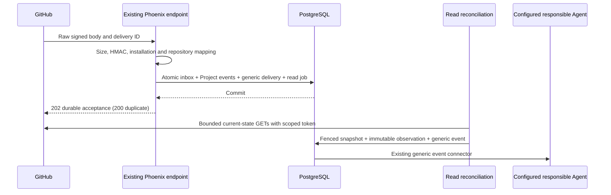

# P4 GitHub repository facts and events

This phase adds read-only GitHub integration to the durable coordination foundation
at `d45adcc`. It does not provision an App, change GitHub permissions, install a live
webhook, or enable repository writes. The implementation lives in `apps/samgita`
and its existing web endpoint. The independent protocol packages remain unchanged.

## Ownership and data flow

An operator configures an existing App installation and explicitly verifies each
repository-to-Project association. A repository's immutable GitHub ID and host are
its external identity. Project UUIDs, canonical Repository UUIDs and existing
ProjectRepository associations remain stable. Supplying `repository_id` upgrades
an existing unverified association in place; conflicting verified identities fail.
Reconciliation updates repository display name/default branch after a rename or
transfer. Old URL aliases and `projects.git_url` remain provenance. Neither a URL
nor a webhook-supplied Project/Agent ID selects authorization.



Webhook receipts record historical evidence. Only API reconciliation updates the
current external-state projection; webhook arrival order is not authoritative.
Samgita Tasks/Attempts/decisions are untouched. An Issue close, PR merge or successful
check is evidence, never Task acceptance. Issue titles/bodies/comments are bounded
untrusted input, not instructions, approvals or delegated authority. An Agent may
read Project context and submit independently authorized management commands.

The existing generic outbox selects the explicitly configured responsible Agent,
without implementation-name checks. No route is created for an unmapped Project;
zero subscribers leaves facts inspectable without selecting a recipient. Delivery
remains at least once, with the existing stable operation/status/recovery contract.
Webhook acceptance, Agent notification acceptance, processing completion and Task
acceptance are distinct.

## Configuration and credentials

Use the existing deployment's external runtime-secret injection mechanism. The
database stores references, never PEM material, webhook secrets or installation
tokens. `SAMGITA_GITHUB_SECRETS` is a runtime JSON object mapping versioned reference
names to secret values; application configuration is `:samgita, :github_secrets`.
For example, metadata can refer to `github-app-key-v1` and `github-hook-secret-v1`.
Supply their values through the deployment secret facility; do not put them in
source, commands, API requests, shell history, fixtures, notes or logs. A key value
is an RSA private-key PEM; the webhook value is the separately configured HMAC
secret. No real credentials are needed for local verification.

`SAMGITA_GITHUB_HOSTS` supplies exact approved API bases and destination IP pins:

```json
{
  "github.example.test": {
    "api_url": "https://github.example.test/api/v3",
    "addresses": ["192.0.2.10"]
  }
}
```

This is illustrative metadata, not a reachable installation. `github.com` requires
`https://api.github.com` and operator-approved current pins too. All resolved IPv4
and IPv6 addresses must be approved. The connection dials a pinned address while
retaining the original hostname for HTTP Host, TLS SNI and certificate validation.
Redirects are rejected. Plain HTTP is allowed only for explicitly approved
loopback fixtures with `allow_insecure: true`. DNS/pin drift fails closed; updating
pins is an operator deployment change, not an automatic trust expansion.

The REST client pins `X-GitHub-Api-Version: 2022-11-28`. It revalidates installation
ID, App ID, suspension, repository ID and required permissions on every operation.
It requests a fresh repository-restricted installation token with exactly
`metadata`, `issues`, `pull_requests`, `checks` and `actions` set to `read`, validates
the returned scope/expiry, and discards the token after the call. Contents access
is unnecessary for this version. The installation may possess broader permissions;
the minted token must have only this read profile. No token cache is persisted.

The sole POST to GitHub is `/app/installations/:id/access_tokens` for authentication.
All repository API traffic is GET. Comments, PR creation, merge, labels, workflow
dispatch and every other repository mutation have no client method or platform
route. The transport itself rejects non-GET calls except this token endpoint.
No real App/security conformance is claimed from these local checks.

Connection identity (host/App/installation) is immutable. Changing credential
references increments the connection version, invalidating repository verification
and in-flight reads. Use new versioned reference names; changing a value under an
unchanged reference is outside the rotation contract. Disable a connection via
`enabled=false`. To resume after suspension, permission failure or rotation, the
operator reconfigures references/state with the expected version, then re-verifies
each explicit repository association. Successful GitHub association commands replay
their authenticated command receipt before any new remote verification.

## Ingress and provenance

`POST /api/github/webhooks/:connection_id` is separately signature-authenticated;
an operator key cannot replace the signature. It retains the existing IP rate limit
(100 requests/minute), reads at most 1 MiB before Plug.Parsers, and verifies exactly
one `X-Hub-Signature-256`, `X-GitHub-Event` and UUID `X-GitHub-Delivery`. HMAC-SHA256
covers exact raw bytes with constant-time comparison before JSON decoding. Oversize
returns 413. Missing/bad headers, malformed JSON and malformed nested IDs fail
without an inbox record. No raw body is passed to normal parameter logging.

The connection's configured installation, verified repository ID/current connection
version, enabled mapping and existing ProjectRepository association must agree.
Project locks are ordered by UUID after the authority and integration locks. Remote
I/O never runs inside these transactions. An integration-wide advisory lock favors
simple, correct fencing over maximum ingestion throughput in this single-tenant
version. At most 100 Projects can be explicitly mapped to one installation/repo.

| Source | Supported first-version facts/actions |
| --- | --- |
| `issues` | Open/edit/delete/transfer, close/reopen, assignment, labels, lock, milestone, pin and type changes. |
| `issue_comment` | Created, edited, deleted; includes parent Issue identity/number. |
| `pull_request` | Open/edit/close/reopen, synchronize, draft/review readiness, assignments, labels, review requests, locks, milestones, queue and auto-merge state. |
| `check_run` | Created, completed, rerequested, requested_action. Requested action is evidence only. |
| `check_suite` | Completed, requested, rerequested. |
| `workflow_run` | Requested, in_progress, completed. |
| Installation controls | Suspend/delete/unsuspend/permission changes fence access; repository removal disables its binding. Added repositories require explicit verification/mapping. |

The exact action allowlist is `GitHub.Payload`. Review events, `workflow_job`,
`push`, `ping` and other unimplemented types/actions return a durable
`state=unsupported` receipt for an otherwise authorized repository, with no Project
notification. Installation-control payloads use their installation scope. Malformed
supported facts fail validation. Unsupported delivery is distinguishable from an
accepted supported event; it does not claim processing.

One transaction inserts `github_deliveries`, append-only `domain_events`, generic
delivery intents/jobs and a targeted reconciliation checkpoint/job. Success means
that transaction committed. An enqueue failure rolls it all back and returns 503;
database unavailability is retryable too. Connection+delivery ID is unique. Exact
replay returns the same receipt/events; a different digest/type under that ID is
409. Current authentication/scope precede replay, so disabled/revoked connections
cannot replay as if still authorized. Existing accepted history remains intact.

The inbox stores source delivery ID, SHA256 digest, installation/repository IDs,
event/action, received time and allowlisted facts/text. Full arbitrary raw bodies,
headers and source URLs are not retained. Generic events preserve source IDs,
external resource IDs and available provider timestamps alongside immutable local
creation/correlation IDs. Text stays behind an explicit `untrusted_input_ref`.

Reconciliation stores latest `github_objects` separately from immutable
`github_observations` (unique object+version). Events reference observation UUIDs,
so later edits cannot rewrite earlier evidence. Project-scoped evidence reads
require a current enabled mapping, current Agent membership/connection and an
original event for that Project. Current facts can be read under a newly approved
mapping; that does not expose another Project's historical source receipt by ID.

## Reconciliation, bounds and recovery

Association creates four scan checkpoints: Issues, PRs, workflow runs and checks on
the current default branch. A minute maintenance job repairs missed wakeups and
starts completed feeds after 15 minutes. Webhooks request individual resource
reads, including comments/check suites. Each worker invocation reads one page of
at most 50 objects; 100 pages is the scan budget. Hitting it records explicit
`dead_letter/page_limit`, never silent completeness. Bodies are capped at 2 MiB,
requests at ten seconds and connection establishment at three seconds. GETs can
be repeated after crashes; no remote execution/write is retried.

Page checkpoints survive failures. A scan-start watermark survives all pages and
retries; the next scan overlaps that start by five minutes, rather than using its
completion time. Issues use the provider `since` filter; other feeds filter locally
while still following pages. A prior query's start time and external update time
prevent stale responses from replacing newer observations. Renames may race a
read; name/default-branch drift fails that read for a later verified scan.

Each read has a 120-second lease, generation and increasing fence. A new request,
expired/reassigned handler, disabled mapping or connection/repository version change
rejects a stale settlement. This is a bounded read handler, not a Task execution
lease. No external write/LLM/tool decision engine is introduced.

Failures are classified as authentication, permission, rate-limit, retryable or
permanent. Authentication/permission loss fences the connection and requires
operator re-verification, retaining inbox/events. 429 is never success. A successful
HTTP response that exhausts quota or supplies Retry-After stops before a follow-on
request. Provider Retry-After/reset deadlines are persisted on the connection and
gate both worker reads and operator association attempts. A two-hour deadline
stays two hours, even if workers wake sooner. Retry backoff starts at five seconds,
with eight consecutive failures and a one-hour backoff cap; provider deadlines
take precedence up to seven days. Longer/malformed/unrepresentable provider delays
pause for explicit recovery. No retry resumes repository writes.

Operator reconciliation resets the four feed checkpoints; targeted rows can be
refreshed by a later accepted webhook. Re-verification is required before recovery
of unavailable scope. Terminal checkpoints/errors are visible with facts. The
generic event API separately supports audited notification redelivery with the
original event identity. Re-ingesting a webhook is not administrative redelivery.

Limits: this repairs bounded current-state gaps, not all missed historical
transitions. Deleted resources may be unavailable; 404 conservatively fences access
because it cannot distinguish deletion from revoked scope. Checks outside the
default branch and missed standalone comments/check suites lack a full sweep.
Pagination is not a GitHub transactional snapshot; this version makes no complete
history or exactly-once external-processing claim. Large repositories can require
operator investigation at the visible scan budget. Full installation-scale fairness,
ETag caching and all-ref check crawling are separate work.

## APIs and rollback

Existing `/api` operator keys and `/api/agent` current machine identity retain their
boundaries. No browser accounts, organizations, UI or privilege-from-capability is
added. API metadata/evidence responses use `Cache-Control: no-store`.

| Route | Access |
| --- | --- |
| `GET/POST /api/github/connections` | Operator configuration/list; `command_id`, and `id`/`expected_version` when updating. |
| `GET/POST /api/projects/:project_id/github/repositories` | Operator list/verify association; POST uses `command_id`, Project `expected_version`, `connection_id`, `external_id`, optional existing `repository_id`. |
| `PATCH .../repositories/:id` | Operator disable using mapping `expected_version` and `enabled=false`; enabling uses verification. |
| `GET .../repositories/:id/facts` | Project-scoped paginated latest facts and bounded sync status. |
| `GET .../repositories/:id/observations/:observation_id` | Immutable reconciliation evidence for this Project. |
| `GET .../repositories/:id/deliveries/:delivery_id` | Immutable allowlisted webhook evidence; ID is the inbox UUID. |
| `POST .../repositories/:id/reconcile` | Operator feed recovery with command ID/mapping expected version. |

Machine Project-member `observer/worker/manager/reviewer` reads use matching
`/api/agent/projects/...` list/facts/evidence routes. Configuration/recovery are
operator-only. References and sanitized metadata can be returned; secret material
and tokens cannot. Missing runtime webhook secrets yield 503 without disclosure.

Migration `20261023000001_add_github_fact_ingestion.exs` adds seven tables and no
historical edits, rekeys, backfills or jobs. Prior migrations remain byte-for-byte
unchanged. Rollback disables ingress/connections and `hub_github`/its minute Cron,
then runs a binary retaining P3/P4 authority guards. Keep all new schema, inbox,
observations, events, receipts and generic notification state. The migration refuses
`down`; never reset/drop or mass-replay. Disabling GitHub does not retract already
accepted notifications. No production migration/cutover is performed here.

## Verification gate

Scoped deterministic coverage is in core `test/samgita/github/`,
`migration/github_preservation_test.exs` and the two web GitHub controller tests.
It covers signed raw bytes/limits, replay/conflicts, installation/mapping/Project
authorization, secret non-disclosure, immutable evidence, atomic enqueue rollback,
missed wakeups, pages/retries/rate limits, stale and concurrent settlements, scan
watermarks and rename identity. The loopback fake GitHub server exercises real
Mint sockets, token scope, version headers, current reads, redirects, write refusal
and response bounds. Concurrency uses distinct PostgreSQL backends. The migration
rehearsal compares P4 historical rows/references/times and refuses destructive down.

Verification on 2026-10-23 passed **124 tests**: the GitHub/isolation suite passed
62 core + 12 web tests (seed `407256`), and affected existing contracts passed
20 core + 30 web tests (seed `147282`). Compilation with warnings as errors,
formatting of changed Elixir files and whitespace checks also passed. These are
local results, not deployment or live GitHub conformance evidence.

Both commands used the existing scratch PostgreSQL socket
`/tmp/samgita-p3-pg/socket`, port `55443`, user `gao`, with manual Oban. The second
database isolates existing tests from intentionally committed concurrency fixtures.
The preservation test creates its own uniquely named scratch database; databases
and fixture history are retained. Reproduce with a separately owned local instance
and equivalent explicit scratch names. This instance's UTF8 databases were created
from `template0` before running the test alias.

```sh
devenv shell --no-tui --no-reload -- env \
  MIX_ENV=test PGHOST=/tmp/samgita-p3-pg/socket POSTGRES_PORT=55443 \
  POSTGRES_USER=gao SAMGITA_TEST_DATABASE=samgita_redesign_github_verify_test \
  mix test apps/samgita/test/samgita/github \
  apps/samgita/test/samgita/migration/github_preservation_test.exs \
  apps/samgita/test/samgita/legacy_isolation_test.exs \
  apps/samgita_web/test/samgita_web/controllers/github_controller_test.exs \
  apps/samgita_web/test/samgita_web/controllers/github_webhook_controller_test.exs

devenv shell --no-tui --no-reload -- env \
  MIX_ENV=test PGHOST=/tmp/samgita-p3-pg/socket POSTGRES_PORT=55443 \
  POSTGRES_USER=gao SAMGITA_TEST_DATABASE=samgita_redesign_github_affected_test \
  mix test apps/samgita/test/samgita/events/transaction_test.exs \
  apps/samgita/test/samgita/events/delivery_test.exs \
  apps/samgita/test/samgita/webhooks_test.exs \
  apps/samgita/test/samgita/platform_test.exs \
  apps/samgita_web/test/samgita_web/controllers/domain_api_test.exs \
  apps/samgita_web/test/samgita_web/controllers/coordination_api_test.exs \
  apps/samgita_web/test/samgita_web/plugs/api_auth_test.exs \
  apps/samgita_web/test/samgita_web/plugs/rate_limit_test.exs
```

All checks use local fakes; none uses real GitHub credentials or a running external
Agent. B5 remains open for real
App installation/authentication, enterprise-host/API differences, pinned egress,
live signature delivery and target-specific permissions. P5 UI, full operator
journey and production backup/release/cutover gates remain outside this phase.
